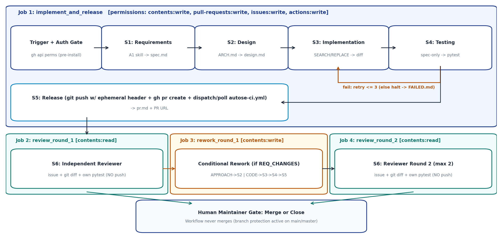
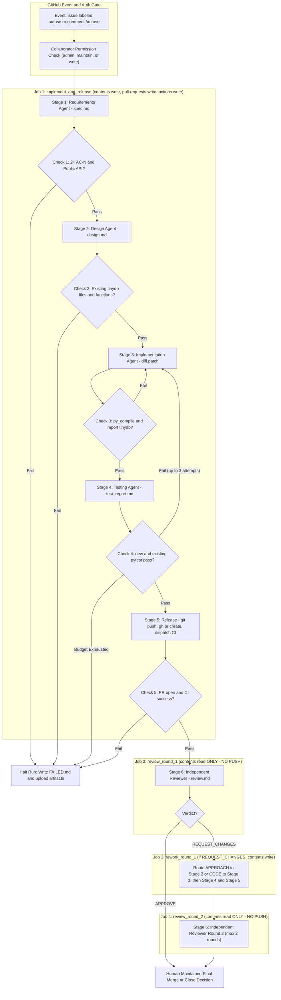

# Architecture Component View

## Mermaid Diagram (Source)

## Components & Permissions

| Component | Job & GitHub Token Permissions | Inputs | Outputs | Tools |
|---|---|---|---|---|
| **Auth Gate** | `implement_and_release` (runs before checkout/install) | `github.actor`, `github.repository` | Pass / Abort | `gh api` collaborator permission |
| **Requirements (S1)** | `implement_and_release` | Wrapped untrusted issue, A1 `spec-skill` | `spec.md` | Gemini API (`gemini-3.1-flash-lite`) |
| **Design (S2)** | `implement_and_release` | `spec.md`, `ARCHITECTURE.md` | `design.md` | Gemini API, file existence check |
| **Implementation (S3)** | `implement_and_release` | `design.md`, target `tinydb/*.py`, failure feedback | `diff.patch` | Gemini API (`SEARCH/REPLACE`), `py_compile`, `git diff` |
| **Testing (S4)** | `implement_and_release` | `spec.md` only (no design/implementer context) | `test_report.md` | Gemini API, `pytest -o addopts=` in `scrubbed_env` |
| **Release (S5)** | `implement_and_release` | Branch, `spec.md`, `test_report.md` | `pr.md`, PR URL | Ephemeral-header `git push`, `gh pr create`, `gh workflow run autose-ci.yml` |
| **Reviewer (S6)** | `review_round_1` / `review_round_2` (`contents: read` ONLY) | Issue text, `git diff origin/<base>...HEAD`, own `pytest` | `review.md` | Gemini API, read-only repo + `pytest`, `gh pr comment` |
